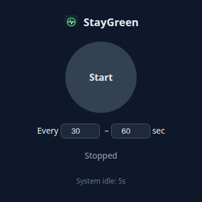
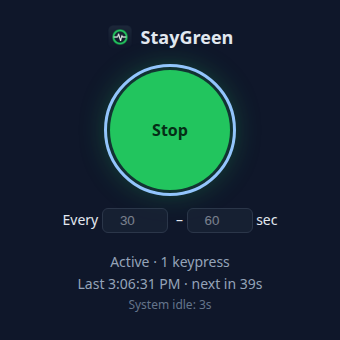

<p align="center">
  
</p>

<h1 align="center">StayGreen</h1>

<p align="center">
  <strong>Keep your Teams status green.</strong><br>
  A tiny tray app that stops Microsoft Teams, Slack & co. from marking you "Away".<br>
  macOS · Windows · Linux
</p>

<p align="center">
  <a href="https://github.com/TheGeekyM/staygreen/releases/latest"></a>
  <a href="https://github.com/TheGeekyM/staygreen/releases"></a>
  <a href="LICENSE"></a>
</p>

<p align="center">
  
  &nbsp;&nbsp;
  
</p>

## Why

Teams marks you **Away** after about 5 minutes without keyboard or mouse input. That includes the times you're reading a long doc, in a meeting room, or getting coffee. StayGreen keeps the idle timer from ever reaching that point.

## Features

- **One-click on/off.** A big Start/Stop button, nothing else to learn.
- **Random intervals.** It presses a key every 30–60 seconds by default, and you set the range.
- **Harmless key.** It presses Shift on macOS/Linux and F15 on Windows, so it never types into what you're doing.
- **Keeps the screen awake** while it's on.
- **Runs in the tray.** Closing the window keeps it running. Start, Stop and Quit are in the tray menu.
- **Live idle counter.** The window shows the system idle time, so you can see each keypress land.
- **Clear errors.** If the OS blocks the keypress (missing Accessibility permission, no `xdotool`), the window says what to fix.
- **Tiny.** About 160 lines of code and no native modules.

Inspired by [sleekhost/stay-active](https://github.com/sleekhost/stay-active), a macOS shell script, rebuilt as a small Electron GUI for macOS, Windows and Linux.

## Which Teams does it work with?

- **Linux:** works with [teams-for-linux](https://github.com/IsmaelMartinez/teams-for-linux) in the background. That app reports "active" to Teams every 10 s whenever the OS isn't idle.
- **Teams in a browser tab or as a Chrome/Edge web app (PWA): only while that window is focused.** A web page only sees input sent to its own window, so if you're working in another window, Teams goes Away.
- **Teams desktop app on Windows/macOS:** should work in the background, because it's expected to read OS-wide idle time. Not tested.

## Download

Get the latest build from [Releases](https://github.com/TheGeekyM/staygreen/releases/latest):

| OS | File |
|----|------|
| macOS (Apple Silicon) | `StayGreen-x.y.z-arm64.dmg` |
| Windows | `StayGreen-Setup-x.y.z.exe` (installer) or `StayGreen-x.y.z.exe` (portable) |
| Linux | `StayGreen-x.y.z.AppImage` |

### First-run notes

- **macOS:** the app is unsigned. If macOS says it is "damaged", run `xattr -cr "/Applications/StayGreen.app"`. Then allow it under **System Settings → Privacy & Security → Accessibility**, or it can't press keys. The app shows an error if permission is missing.
- **Windows:** SmartScreen may warn on first launch. Click **More info → Run anyway**.
- **Linux:** needs `xdotool` (`sudo apt install xdotool`) and an X11 session. Wayland is not supported. Run `chmod +x *.AppImage` first. Run it as your normal user, not root or sudo: as root the window comes up empty, so the app now refuses and says why.

## Linux: add to app menu (optional)

AppImages don't add themselves to the app menu. To get the icon in your launcher and dock:

```bash
mkdir -p ~/.local/share/icons ~/.local/share/applications
curl -fsSL https://raw.githubusercontent.com/TheGeekyM/staygreen/main/icon.png -o ~/.local/share/icons/staygreen.png
cat > ~/.local/share/applications/staygreen.desktop <<EOF
[Desktop Entry]
Name=StayGreen
Exec=$HOME/Applications/StayGreen.AppImage
Icon=$HOME/.local/share/icons/staygreen.png
Type=Application
Categories=Utility;
StartupWMClass=staygreen
EOF
```

Change the `Exec` path to wherever you saved the AppImage.

## Run from source

```bash
npm install
npm start
```

The **System idle** counter in the window should drop to 0 after each keypress. If it doesn't, the keypress isn't registering on your system.

## Release

Push a `v*` tag. GitHub Actions builds for all three OSes and attaches the files to a GitHub Release.

```bash
npm version patch && git push --follow-tags
```

## License

MIT
